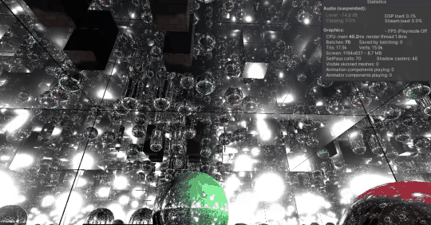

# Egan's Raytracer — SQL Radiance Live V3

A high-performance, real-time GPU radiance caching and global illumination raytracer for Unity's **Universal Render Pipeline (URP 14 / Unity 2022.3+)**.

**Egan's Raytracer (SQL Radiance Live V3)** provides fully dynamic, real-time multi-bounce diffuse global illumination, infinite and multi-bounce specular reflections, real-time area lights, and dynamic raytraced shadow occlusion without offline baking, precomputed lightmaps, or raytracing hardware (RTX/DXR) requirements.

<p align="center">
  
  <br>
  <em>Live in-engine footage showcasing real-time multi-bounce recursive reflections and dynamic radiance caching.</em>
  <br><br>
  
</p>

---

V4 will include:
1: My volumetric atmosphere and cloud sim
2: Proper sky rendering
3: Bounce lighting on Spot lights
4: Minor shadow fix

### Acknowledgments

- **Gemini 3.8 Flash** for fast prototyping & architectural formulation. ([codex-session-SQL Radiance V2 and V3 Analysis.md](codex-session-SQL%20Radiance%20V2%20and%20V3%20Analysis.md))
- **Astra** for making it Realtime.
- **Me** for the original hypothesis and core concept.

---

## Table of Contents

1. [Architecture Overview](#architecture-overview)
2. [Core Features](#core-features)
   - [Real-Time Diffuse Global Illumination](#1-real-time-diffuse-global-illumination-spatial-transport)
   - [Infinite & Multi-Bounce Specular Reflections](#2-infinite--multi-bounce-specular-reflections)
   - [All Five Unity Light Types & Real-Time Area Lights](#3-all-five-unity-light-types--real-time-area-lights)
   - [Dual-Tier Cache & Hardware Bilinear Filtering](#4-dual-tier-cache--hardware-bilinear-filtering)
   - [Analytic Primitives & Mesh BVH Traversal](#5-analytic-primitives--mesh-bvh-traversal)
   - [Procedural Texture Patterns](#6-procedural-texture-patterns)
3. [SkinnedMeshRenderer Status & Roadmap](#skinnedmeshrenderer-status--roadmap)
4. [Settings & Configuration Reference](#settings--configuration-reference)
5. [Shader & Compute Architecture](#shader--compute-architecture)
6. [Scene Registry & Lifecycle](#scene-registry--lifecycle)
7. [System Limits & Specifications](#system-limits--specifications)
8. [Getting Started & Quick Setup](#getting-started--quick-setup)

---

> [!WARNING]
> **SkinnedMeshRenderer Implementation Notice:**  
> The current `SkinnedMeshRenderer` support is an **initial, provisional implementation and is still to be properly implemented**.  
> Currently, bone animations and blend shapes are captured on the CPU using `BakeMesh` once per character per frame, and the triangle Bounding Volume Hierarchy (BVH) bounds are refitted bottom-up without rebuilding topology. This introduces CPU overhead proportional to character vertex counts. A production GPU-driven compute-skinning pipeline with direct stream-out and specialized deformation caches is planned for a future update.

---

## Architecture Overview

```
                                      +---------------------------------------------+
                                      |             Scene Scene Graph               |
                                      |  (MeshRenderers, SkinnedMeshRenderers,      |
                                      |   Directional, Point, Spot, Area Lights)    |
                                      +---------------------------------------------+
                                                             |
                                                 LateUpdate() / Auto-Discovery
                                                             v
+-------------------------------------------------------------------------------------------------------------------------+
|                                              SQLRadianceV3System                                                         |
|  - Registry auto-discovery (1 Hz periodic check or on-demand rebuild)                                                    |
|  - Light serialization (up to 32 lights packed into float4[192])                                                         |
|  - Material atlas blitting (128x128 32-slice albedo and emission arrays)                                                |
|  - Budgeted ring-buffer dispatcher (samplesPerFrame cursor)                                                             |
+-------------------------------------------------------------------------------------------------------------------------+
       |                                                                                           |
       v (CPU Geometry Processing)                                                                 v (GPU Compute Dispatches)
+-----------------------------------------------+                                         +----------------------------------+
|            SQLRadianceV3Geometry              |                                         |      Resources/SQLV3Lighting     |
| - Analytic primitives (Sphere, Box, Plane,    |                                         |  - CopyCache Kernel:             |
|   Capsule): 8x8 patches per face (384/shape)  |                                         |    Double-buffering persistence  |
| - Custom meshes: Vertex-level sampling        |                                         |  - UpdateCache Kernel:           |
| - Mesh BVH: Top-down build with escape indices|                                         |    * Direct lighting evaluation  |
| - SkinnedMeshRenderer (Provisional):          |                                         |    * 4-sample Area Light MC      |
|   CPU BakeMesh + bottom-up BVH AABB refit     |                                         |    * Raytraced shadow visibility |
+-----------------------------------------------+                                         |    * Cosine-weighted GI bounce   |
       |                                                                                  |    * Dominant light tracking     |
       | Uploads buffers                                                                  |    * Hardware atlas encoding     |
       v                                                                                  +----------------------------------+
+------------------------------------------------------------------------------------+                     |
|                                     GPU Buffers                                     |                     |
|  * _SQL3Vertices       (float4 pos/entity, float4 norm, float4 uv)                 |                     | Writes into
|  * _SQL3Nodes          (float4 min/leftOrFirst, float4 max/escapeOrCount)          |                     |
|  * _SQL3Triangles      (float4 v0, v1, v2, entityIndex)                            |                     v
|  * _SQL3Cache          (StructuredBuffer<SQL3Lighting>: direct, indirect, area,    |<--------------------+
|                         dominantDir, dominantRad)                                   |
|  * _SQL3LightingAtlas  (2D Texture Array 48x256, 5 slices, Bilinear Filtered)      |
+------------------------------------------------------------------------------------+
                                           |
                                           v Reads during rasterization
+-------------------------------------------------------------------------------------------------------------------------+
|                                              SQLRadianceLiveV3Lit Shader                                                 |
|  - URP 14 Forward / Forward+ pass                                                                                       |
|  - Evaluates native URP punctual lights + dynamic shadow cascades                                                        |
|  - Samples Cached Diffuse GI (bilinear atlas for primitives, barycentric vertex lerp for meshes)                         |
|  - Adds Area Light direct diffuse contribution                                                                           |
|  - Evaluates up to 32-bounce Specular Reflection rays (Analytic + BVH traversal)                                         |
|  - Computes closed-form Neumann tail for infinite mirror reflections                                                    |
|  - Evaluates dominant-light specular highlight per hit without nested light loops                                        |
+-------------------------------------------------------------------------------------------------------------------------+
```

---

## Core Features

### 1. Real-Time Diffuse Global Illumination (Spatial Transport)

Rather than relying on ambient scalar approximations, Live V3 models **physically grounded spatial radiance transport**:
- **Fixed-Point Recurrence Formulation**:
  $$\mathbf{L} = \mathbf{E} + \boldsymbol{\rho} \cdot (\mathbf{D} + \mathbf{T}\,\mathbf{L})$$
  Where $\mathbf{E}$ is surface emission, $\boldsymbol{\rho}$ is diffuse surface albedo $(1 - \text{metallic}) \times 0.96$, $\mathbf{D}$ is direct incoming irradiance, and $\mathbf{T}\,\mathbf{L}$ is transported incoming radiance gathered from previous-frame cache hits.
- **Monte Carlo Cosine-Weighted Hemisphere Sampling**:
  During each update dispatch, surface samples shoot configurable GI rays (`giRaysPerSample`, default 4, up to 32) distributed over the hemisphere using a low-discrepancy pseudo-random sequence (`SQL3Sequence`).
- **Textured Emission as Light Sources**:
  Surfaces with textured emission maps physically illuminate nearby geometry. Updating the emission texture or color changes the indirect bounce energy across the scene in real time.
- **Temporal EMA Accumulation**:
  Incoming indirect radiance is temporally accumulated using an exponential moving average (`historyWeight`, default 0.65), eliminating noise and flicker without high ray counts.
- **Instant Toggle**:
  Disabling `globalIllumination` instantly clears indirect bounce energy without leaving stale artifacts in the cache.

### 2. Infinite & Multi-Bounce Specular Reflections (Currently limited to 32 bounces for my hardware)

Live V3 provides full-scene raytraced reflections directly inside the forward fragment shader:
- **Analytic + BVH Intersection**:
  Rays trace against both rigid analytic primitives (spheres, boxes, planes, capsules) using exact closed-form math and custom meshes via the BVH.
- **32-Step Loop Limit**:
  Ray reflections are explicitly traced up to a hard ceiling of 32 bounces per ray to ensure predictable GPU frame budgets.
- **Closed-Form Infinite Tail (Neumann Series)**:
  When configuring infinite bounces (`limitedBounces = false` or `maxBounces > 32`), remaining energy between facing mirrors is computed using an approximate closed-form tail factor:
  $$\text{Tail} = \frac{k}{1 - k}$$
  where $k$ is the reflection feedback gain (`reflectionFeedback`, default 0.92). This produces infinite mirror depth without adding ray tracing iterations or dropping frame rate.
- **Cached Dominant Specular Lighting**:
  At each reflection bounce hit, the shader extracts the **dominant light direction and dominant radiance** stored in the cache. This evaluates sharp specular highlights on metallic surfaces within reflections without running an expensive per-light loop or shadow test at every reflection bounce.

### 3. All Five Unity Light Types & Real-Time Area Lights

Live V3 manages up to 32 scene lights in a unified light buffer (`_SQL3Lights`):
1. **Directional Lights**: Infinite orthogonal rays with distance cutoff.
2. **Point Lights**: Inverse-square falloff with smooth range attenuation.
3. **Spot Lights**: Dual-cone inner and outer angle attenuation.
4. **Rectangle Area Lights**: Real-time diffuse integration via Monte Carlo area sampling.
5. **Disc Area Lights**: Real-time circular area sampling with radial distribution.

> [!NOTE]
> **Real-Time Area Lights in URP 14:**  
> In stock URP 14, Rectangle and Disc area lights are baked-only and cannot cast real-time light. Live V3 evaluates their direct diffuse illumination and soft occlusion entirely in the compute cache, allowing dynamic real-time area lights to illuminate both static and moving objects.

- **Dynamic Shadow Occlusion**:
  Direct lighting within the cache performs real-time raytraced visibility checks (`SQL3Visibility`) against scene occluders with configurable `shadowBias` (default 0.015).
- **Shadow Flags & Layers**:
  Occluders respect `Renderer.shadowCastingMode != ShadowCastingMode.Off` and light culling masks (`Light.cullingMask`).

### 4. Dual-Tier Cache & Hardware Bilinear Filtering

Live V3 optimizes storage and sampling based on geometric representation:

| Geometric Class | Sampling Scheme | Storage Target | Filtering Method |
|---|---|---|---|
| **Analytic Primitives** (Sphere, Cube, Plane, Capsule) | 8x8 sample grid per face (384 samples/entity) | `_SQL3LightingAtlas` (2D Texture Array: 48x256, 5 slices) | **Hardware Bilinear Filtering** directly on the GPU texture unit. |
| **Custom Meshes & Skinned Characters** | 1 sample per mesh vertex | `_SQL3Cache` (StructuredBuffer of `SQL3Lighting` structs) | **Barycentric Interpolation** across triangle vertices in shader. |

The 5 slices of `_SQL3LightingAtlas` store:
- **Slice 0**: Direct Diffuse Irradiance (`float4`)
- **Slice 1**: Indirect Diffuse GI (`float4`)
- **Slice 2**: Direct Area Light Irradiance (`float4`)
- **Slice 3**: Dominant Light Direction (`float4`)
- **Slice 4**: Dominant Light Radiance (`float4`)

### 5. Analytic Primitives & Mesh BVH Traversal

- **Analytic Shapes (0–3)**:
  - **Sphere (0)**: Uniform radius with local center offset.
  - **Box / Cube (1)**: Oriented bounding box with local ray transformation.
  - **Plane / Quad (2)**: Local XZ (Plane) or XY (Quad) planar boundary checks.
  - **Capsule (3)**: Cylinder shaft with spherical endcap intersection along local Y.
- **Custom Triangle Meshes (Shape 4)**:
  - Structured bounding volume hierarchy built over triangles.
  - Nodes store bounding box minimum and maximum in 32 bytes (`SQL3Node`).
  - **Escape-Index Traversal**: Internal nodes contain an escape index in `maximum.w`. If a ray misses an AABB, it jumps directly to the escape index, avoiding branch divergence and stack manipulation on the GPU.

### 6. Procedural Texture Patterns

Surfaces support 5 built-in procedural patterns evaluated analytically in HLSL without texture memory:
- **Pattern 1 — Luxury Polished Checkerboard Tiles**: Surface-aligned 2D tiles with dark/light base tone modulation and subtle mortar border lines.
- **Pattern 2 — Jade / Marble Swirled Mineral Veins**: Non-linear trigonometric noise synthesizing mineral veins.
- **Pattern 3 — Gold Brushed Metal / Cyber Grid**: High-frequency anisotropic metallic grid pattern.
- **Pattern 4 — Terracotta Staggered Brick Grid**: Staggered alternating brick layout with procedural color variation and mortar boundaries.
- **Pattern 5 — Hexagonal Honeycomb Matrix**: Distance-field hexagonal cells with darkened edge borders.

---

## SkinnedMeshRenderer Status & Roadmap

> [!CAUTION]
> **Important Notice on SkinnedMeshRenderer Implementation:**  
> The current `SkinnedMeshRenderer` pipeline is an **initial, provisional implementation and is still to be properly implemented**.

### Current Implementation Details
1. **CPU Mesh Baking (`BakeMesh`)**:
   During `SQLRadianceV3Geometry.Sync()`, each active `SkinnedMeshRenderer` has its deformed posture and blend shapes captured into a scratch mesh snapshot using Unity's `skin.BakeMesh(snapshot)`.
2. **Deformed Vertex Extraction**:
   Transformed vertex positions and normals are read back on the CPU and updated into the GPU `_SQL3Vertices` compute buffer via `VertexBuffer.SetData(...)`.
3. **Bottom-Up BVH Refit**:
   Rather than rebuilding the BVH acceleration tree topology from scratch, `SQLRadianceV3Geometry.Refit()` walks the pre-existing node hierarchy in reverse bottom-up order, refitting the bounding boxes around the deformed triangles.

### Known Limitations of Current Implementation
- **CPU Bottleneck**: Invoking `BakeMesh` and copying vertex buffers on the CPU scales linearly with character vertex complexity and bone counts.
- **Memory Allocations**: Temporary vertex lists and mesh snapshots require managed memory tracking.
- **Topology Restrictions**: Mesh swaps or LOD changes require a full scene registry rebuild; indexing mismatched topologies will corrupt BVH traversal.
- **No GPU Compute Skinning**: Vertex skinning is not currently computed directly in a compute pass on the GPU.

### Future Roadmap for Skinned Meshes
- [ ] Direct GPU compute-skinning pass reading bone transform matrices from a structured buffer.
- [ ] Stream-out deformed vertices directly into `_SQL3Vertices` without CPU round-trips.
- [ ] GPU-driven parallel BVH refit compute shader.
- [ ] Seamless Level-of-Detail (LOD) transitions and dynamic submesh allocation.

---

## Settings & Configuration Reference

The `SQLRadianceV3Settings` class exposes full control over visual quality and performance budgets:

```csharp
[Serializable]
public sealed class SQLRadianceV3Settings
{
    // Reflections & Mirror Settings
    public bool reflections = true;               // Enables raytraced specular reflections
    public bool limitedBounces = false;           // If false, uses Neumann series infinite tail
    [Range(1, 4096)] public int maxBounces = 4096;// Maximum reflection bounce ceiling
    [Range(0, 0.96f)] public float reflectionFeedback = 0.92f; // Feedback gain (k) for infinite tail

    // Global Illumination Settings
    public bool globalIllumination = true;        // Enables spatial diffuse GI transport
    [Range(64, 16384)] public int samplesPerFrame = 2048; // Surface lighting sample budget / frame
    [Range(1, 32)] public int giRaysPerSample = 4;// Cosine-weighted hemisphere rays per sample
    [Range(0, 0.95f)] public float historyWeight = 0.65f; // Temporal EMA accumulation weight
    [Range(0.001f, 0.05f)] public float shadowBias = 0.015f; // Raytraced shadow offset bias
    [ColorUsage(false, true)] public Color environment = Color.black; // Sky / miss radiance

    // Geometry & Discovery
    [Range(1024, 131072)] public int meshVertexBudget = 65536; // Maximum mesh vertex sample count
    public LayerMask inclusionMask = ~0;          // Layer mask for participating renderers

    // Debugging
    [Range(0, 3)] public int debugView;           // 0: Full, 1: Indirect GI, 2: Reflections, 3: Direct
}
```

### Debug Views

| Mode | Name | Description |
|---|---|---|
| `0` | **Full Lighting** | Standard output combining direct lighting, area lights, diffuse GI, reflections, and emission. |
| `1` | **Indirect Only** | Isolates the multi-bounce diffuse GI contribution. |
| `2` | **Reflections Only** | Isolates raytraced specular reflections and mirror bounces. |
| `3` | **Direct Lighting** | Isolates native direct punctual lights, area lights, and shadow maps. |

---

## Shader & Compute Architecture

### File Layout

```
Assets/Shaders/SQLRadianceCachingLightingInferenceV3/
├── Editor/
│   ├── Rackneh.InferenceLighting.SQLRadianceLiveV3.Editor.asmdef
│   ├── SQLRadianceV3Editor.cs          # Custom inspector & scene creation tools
│   ├── SQLRadianceV3Validation.cs      # Automated GPU validation suite & benchmarks
│   └── SQLV3Validation.compute        # GPU ray validation kernel
├── Runtime/
│   ├── Rackneh.InferenceLighting.SQLRadianceLiveV3.Runtime.asmdef
│   ├── SQLRadianceV3Geometry.cs        # Mesh analysis, patch generation, BVH builder & refitter
│   ├── SQLRadianceV3System.cs          # System lifecycle, light serialization, compute dispatching
│   ├── SQLV3DemoMotion.cs              # Interactive demo motion animator
│   ├── Resources/
│   │   └── SQLV3Lighting.compute       # CopyCache & UpdateCache kernels
│   └── Shaders/
│       ├── SQLRadianceV3Lit.shader     # UniversalForwardOnly, ShadowCaster, Depth, DepthNormals
│       ├── SQLV3Patterns.hlsl          # 5 procedural texture pattern shaders
│       ├── SQLV3Primitives.hlsl        # Analytic sphere, box, plane, capsule intersection
│       ├── SQLV3Reflections.hlsl       # Multi-bounce reflection tracer & Neumann tail
│       └── SQLV3Scene.hlsl             # Global structs, BVH traversal, lighting sampling
├── ConvertedMaterials/                 # Auto-generated converted scene materials
├── Demo/                               # Interactive feature demo scene & assets
│   ├── Character.asset                 # Generated validation skinned mesh
│   ├── EmissionChecker.asset           # Procedural checkerboard emission texture
│   ├── SQLV3Features.unity             # Complete feature showcase scene
│   └── Material0..4.mat                # Materials for demo objects
├── README.md                           # Directory-level documentation
└── SQLTestV3.unity                     # Isolated V3 test scene
```

### Compute Kernels (`SQLV3Lighting.compute`)

1. **`CopyCache` (`[numthreads(64, 1, 1)]`)**:
   Preserves persistent lighting states for samples outside the current frame's update slice.
2. **`UpdateCache` (`[numthreads(64, 1, 1)]`)**:
   Processes `UpdatedSamples` in a round-robin cursor ring:
   - Direct punctual light evaluation.
   - Monte Carlo area light evaluation (4 samples/light).
   - Raytraced shadow visibility checks against primitives and mesh BVH.
   - Cosine-weighted hemisphere diffuse GI sampling against previous-frame radiance.
   - Dominant light extraction for reflection specular lighting.
   - Writes to `_SQL3WriteCache` and packs primitive samples into `_SQL3WriteAtlas`.

---

## Scene Registry & Lifecycle

- **Automatic Scene Discovery**:
  Once every second (`nextDiscovery`), `SQLRadianceV3System` scans the scene for active `MeshRenderer` and `SkinnedMeshRenderer` components on layers matching `inclusionMask`.
- **Registry Hash**:
  Computes an aggregate hash across renderer instance IDs, mesh instance IDs, and shared material IDs. If an object is added, removed, or has its mesh/material modified, `Rebuild()` is automatically invoked.
- **Manual Rebuild**:
  Call `system.Rebuild()` or click **"Rebuild scene registry"** in the inspector to immediately refresh all slots.
- **Zero-Bake Property Changes**:
  Object transforms, light positions/intensities/colors, and material emission colors update dynamically every frame without triggering a rebuild.

---

## System Limits & Specifications

| Resource | Hard Limit / Default | Behavior on Exceeding |
|---|---|---|
| **Surface Slots** | 32 slots maximum | Renderers beyond 32 are excluded with an inspector warning. |
| **Cached Lights** | 32 lights maximum | Excess lights fall back to native URP punctual direct lighting (no area light or cache GI). |
| **Mesh Vertices** | 65,536 (configurable up to 131,072) | Heavy meshes exceeding budget are excluded from the cache. |
| **Primitive Face Resolution** | 8x8 samples per face (384 / primitive) | Fixed grid; use triangle meshes if higher spatial fidelity is required. |
| **Material Texture Atlas** | 128x128 per material (32 slices) | Downsampled/blitted automatically from `_BaseMap` and `_EmissionMap`. |
| **Reflection Bounces** | 32 physical ray iterations | Converges higher bounce requests (> 32) using closed-form Neumann tail. |
| **Active Systems** | 1 active system per scene context | Singleton enforcement (`owner == this`); secondary systems log a warning and deactivate. |

---

## Getting Started & Quick Setup

### 1. Opening the Feature Demo
1. Open the scene `Assets/Shaders/SQLRadianceCachingLightingInferenceV3/Demo/SQLV3Features.unity`.
2. Enter **Play Mode** to see animated rigid geometry, bone-animated skinned character, emissive checkerboard panel, and all 5 Unity light types updating in real time.

### 2. Adding SQL Radiance Live V3 to an Existing Scene
1. Create an empty GameObject in your scene named `SQL Radiance System`.
2. Attach the `SQLRadianceV3System` component.
3. Configure settings in the inspector (default settings are tuned for balanced performance and fidelity).
4. For any renderer that should receive cached lighting and reflections:
   - Change its material shader to `InferenceLighting/SQLRadianceLiveV3Lit`.
5. For imported static or custom meshes, ensure **Read/Write Enabled** is checked in their FBX/Model Import Settings.

### 3. Editor Tools Menu
Access the editor utilities via the Unity menu bar under **Tools > Inference Lighting > SQL V3 Live**:
- **Create feature demo**: Generates a self-contained feature demonstration scene with all assets (`Demo/SQLV3Features.unity`).
- **Create V3 copy of active scene**: Duplicates your current scene as `SQLTestV3.unity`, converts materials to `SQLRadianceLiveV3Lit`, and configures the system without modifying your original scene.
- **Run GPU validation**: Executes the full GPU correctness suite.
- **Capture and benchmark feature demo**: Renders benchmark comparisons and timing logs to `Tools/sql-live-v3-validation/`.

---

## Author & Project Info

- **Repository**: [`Rackneh/Egan-s-Raytracer`](https://github.com/Rackneh/Egan-s-Raytracer)
- **Component**: SQL Radiance Live V3 (`SQLRadianceCachingLightingInferenceV3`)
- **Assembly Definitions**:
  - `Rackneh.InferenceLighting.SQLRadianceLiveV3.Runtime`
  - `Rackneh.InferenceLighting.SQLRadianceLiveV3.Editor`
- **Target Platform**: Unity 2022.3 LTS / URP 14+ (DirectX 11+, Vulkan, Metal with Compute Shader support).
